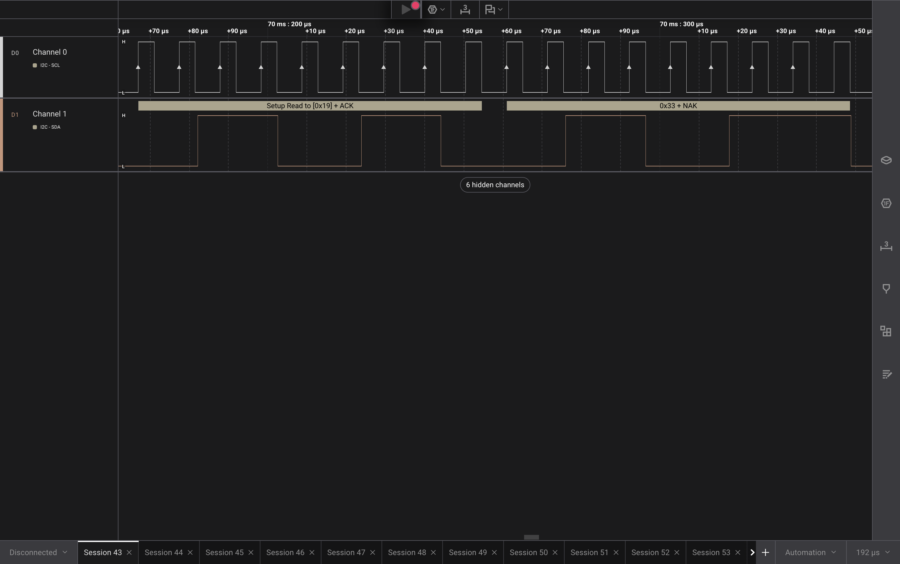
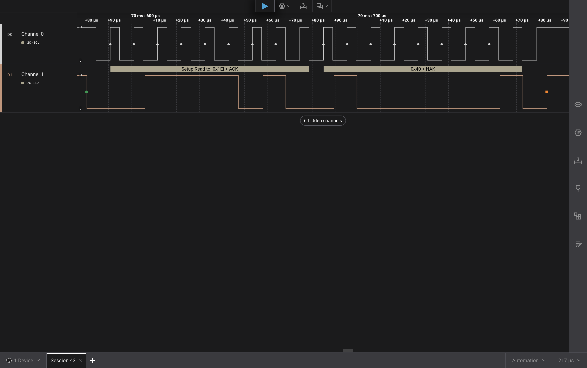
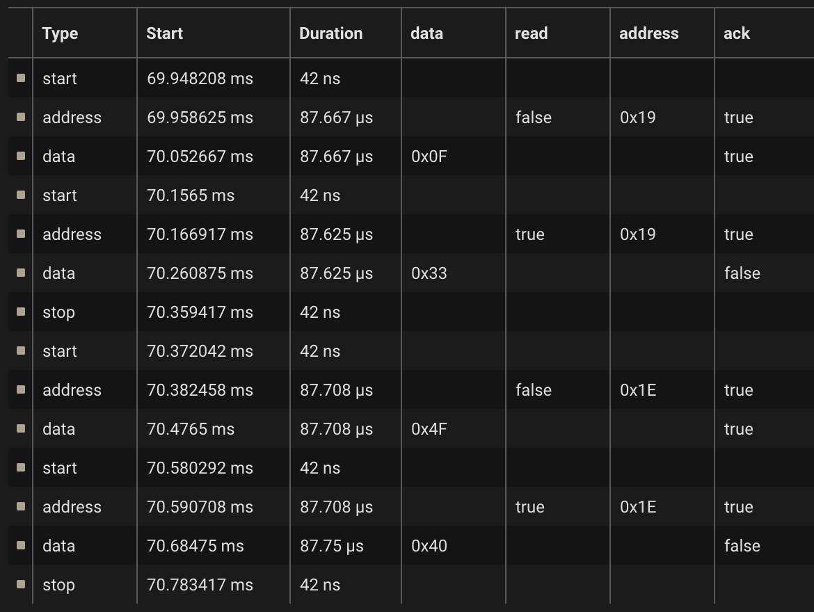

# ee186_lab3

## Getting Ready

**I2C addresses** (b = R/W bit)

```
accelerometer: 0011001b   (0x19)
magnetometer:  0011110b   (0x1E)
```

**Sub-address**

SUB is the byte sent after the device address, and selects which register
inside the chip is being written / read. This differs from the I2C address,
which picks which chip on the bus you're talking to. The I2C address is the
first byte sent after START, whereas SUB is the second one. The I2C address is
fixed in hardware, while the SUB is chosen from the register map in the datasheet.

**CTRL1 register address and value**

```
Address:     0100000  (0x20)   <- 7 bits; the SUB's top bit is the auto-increment flag
Written to:  01010111 (0x57)
```

CTRL_REG1_A is at address 0x20. Writing 0x57 sets ODR = 0101 (100 Hz), normal mode
(LPen = 0), and enables the X, Y and Z axes (Zen = Yen = Xen = 1).

**Reading acceleration data from axes** (8-bit sub-addresses)

```
OUT_X_L_A:  00101000 (0x28)
OUT_X_H_A:  00101001 (0x29)
OUT_Y_L_A:  00101010 (0x2A)
OUT_Y_H_A:  00101011 (0x2B)
OUT_Z_L_A:  00101100 (0x2C)
OUT_Z_H_A:  00101101 (0x2D)
```

With auto-increment (MSB = 1), `0xA8` (10101000) reads all six in one transaction.

## Writing the Driver

WHO_AM_I_A (0x0F, device 0x19) returned **0x33** and WHO_AM_I_M (0x4F, device 0x1E)
returned **0x40**, matching datasheet.

Code: [`3-writing-the-driver/main.c`](3-writing-the-driver/main.c)





## Measuring Gravity

Code: [`4-measuring-gravity/main.c`](4-measuring-gravity/main.c)
Video: [`4-measuring-gravity/IMG_0188.MOV`](4-measuring-gravity/IMG_0188.MOV)
